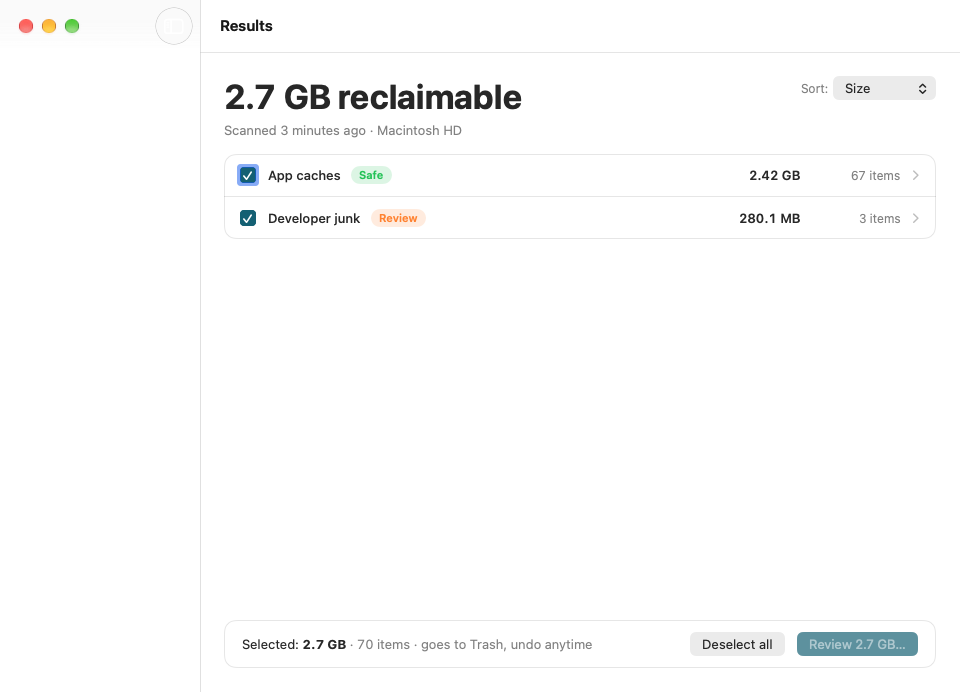

# Data Debris

**Find it, review it, clear it.**

A native macOS disk cleaner that finds reclaimable data — app caches, logs, developer
leftovers, duplicates, large forgotten files — shows all of it, and removes only what you
approve, reversibly.

It is built around one design promise — **nothing is removed that you have not seen and
approved** — and one technical promise — **every removal is journaled and undoable**.

<p align="center">
  
</p>

## Why it exists

Competitors hide what they delete behind a big "Clean" button. Here the item list *is* the
product: every candidate file is shown with its size and the reason a rule claimed it, and
nothing moves until you tick it.

It is **not** a speed booster, antivirus, uninstaller or RAM cleaner, and it never touches
`/System`. Those are the features that give cleaners a bad name.

## Status

Pre-release. The engine, UI and licensing service are implemented and tested; signing,
notarization and Sparkle updates are not yet wired up.

| Suite | Tests |
|---|---|
| `DebrisCoreTests` (engine) | 116 |
| `DebrisAppTests` (UI/purchase) | 45 |
| `license-worker` (vitest) | 24 |

## Safety invariants

These are the rules the engine is built to guarantee. Each one has tests; none may be
traded away for convenience. Full text in [`CLAUDE.md`](CLAUDE.md) and §4 of the
[product spec](docs/product-spec.md).

| | Invariant |
|---|---|
| **S1** | **Allowlist only.** A file is removable only if a catalogue rule claims it. Unknown = untouched. |
| **S2** | **One gate.** Every manual removal passes through Review. Auto Clean removes only rules ticked *and* marked `autoCleanEligible`. |
| **S3** | **Trash by default** via `FileManager.trashItem`. Permanent delete is per-run, double-confirmed, never in Auto Clean. |
| **S4** | **Journal before move.** The item row is written and `fsync`'d *before* the move. |
| **S5** | **Undo** while items remain in Trash; restore to the original path or a `" (restored)"` suffix. |
| **S6** | **Re-verify at clean time.** Re-stat; skip if size/mtime/inode changed or the file is open. |
| **S7** | A duplicate group **never ends with zero kept copies**. |
| **S8** | **User authority only.** No root, no privileged helper, no `sudo`, ever. |
| **S9** | **No silent scope creep.** External volumes are opt-in by UUID; new rules ship unticked for Auto Clean. |
| **S10** | **Honest numbers.** Allocated blocks; clones/hardlinks excluded; "moved to Trash" is not "freed". |

Protected paths (`/System`, `/usr`, other users' homes, Photos/Music/Final Cut libraries,
Mail data, VCS working trees, Time Machine snapshots, …) are hard-coded, shown in Settings,
and are never preferences.

## Requirements

- macOS 13 Ventura or later (Apple Silicon + Intel)
- Xcode 15 or later
- [XcodeGen](https://github.com/yonaskolb/XcodeGen) — `brew install xcodegen`

The Xcode project is **generated** from [`project.yml`](project.yml) and is not committed.
Edit `project.yml`, never `DataDebris.xcodeproj`.

## Build and run

```sh
make gen     # regenerate DataDebris.xcodeproj from project.yml
make build   # debug build
make test    # DebrisCoreTests + DebrisAppTests — run this before calling a change done
make run     # build, then launch the app
make clean   # remove build/ and the generated project
```

There is also an SPM manifest for fast engine iteration and a debug scanner CLI:

```sh
swift run debris-scan
```

Development builds use "Sign to Run Locally" (`CODE_SIGN_IDENTITY = "-"`, no team), so no
Apple Developer account is needed to build or test.

> **Launching the app from a terminal:** a directly executed binary inherits the terminal's
> TCC permissions, which makes Trash restore fail. Use `make run` (or `open -n`) so the app
> gets its own permission context.

## Layout

```
Sources/DebrisCore     engine: catalogue, scanner, rule matcher, duplicates,
                       journal/executor/restore, Auto Clean, licensing. No UI.
Sources/DebrisApp      SwiftUI app: Home, Scanning, Results, Review, Done,
                       Duplicates, History, Settings, purchase flow.
Sources/DebrisCLI      debris-scan, a debug scanner for engine iteration.
Tests/                 DebrisCoreTests, DebrisAppTests, Fixtures.
services/license-worker  Cloudflare Worker: Paddle webhooks -> signed licenses.
docs/                  product-spec.md (§1-§15), ui-spec.md (Screens 0-13), design/.
```

Engine code is written before UI, and gets tests before UI.

## Documentation

| Document | What it covers |
|---|---|
| [docs/product-spec.md](docs/product-spec.md) | Authoritative product & technical spec, §1–§15 |
| [docs/ui-spec.md](docs/ui-spec.md) | Every screen, Screens 0–13 |
| [DEPLOYMENT.md](DEPLOYMENT.md) | Release: signing, notarization, DMG, worker deploy |
| [CONTRIBUTING.md](CONTRIBUTING.md) | Working style, commit format, the test gate |
| [SECURITY.md](SECURITY.md) | Reporting a vulnerability |
| [services/license-worker/README.md](services/license-worker/README.md) | License service endpoints and secrets |

When this file and the spec disagree, **the spec wins**.

## Pricing

Free forever: unlimited scans and full results with reasons, exclusions, History viewer.

| Plan | Price | Includes |
|---|---|---|
| **1 Year** | $20 | Cleaning, Undo, Duplicates, Auto Clean, updates for the term. 2 Macs. |
| **3 Years** | $50 | Same, 3-year term. 2 Macs. |

Auto-renew is **off by default**. When a term lapses the app returns to Free — scanning and
results keep working, cleaning locks, and History and Undo of past runs remain available.
Payment is through Paddle as merchant of record; the app never sees card details. Before any
price is shown, the Privacy & Security sheet must be acknowledged.

## Privacy

Scanning is entirely local. No file names, paths, contents or scan results ever leave the
machine. The app is not sandboxed (direct distribution) and runs with Hardened Runtime on,
with **user authority only** — no root, no privileged helper, no `sudo`.

## License

Proprietary — all rights reserved. See [LICENSE](LICENSE).
